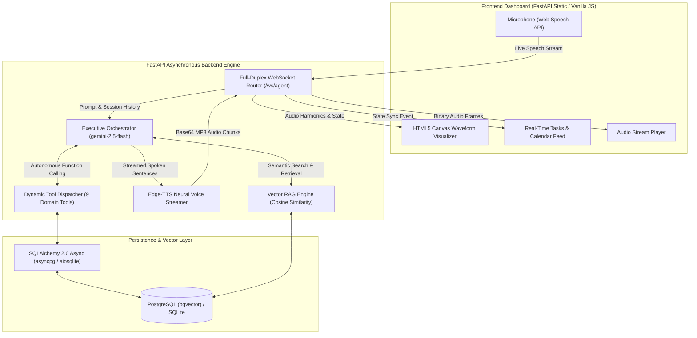

# ARIA // Executive AI Voice Agent 🎙️⚡

> **An enterprise-grade, low-latency Full-Stack Python AI Voice Agent featuring real-time WebSockets, Microsoft Neural TTS, Google Gemini function calling, and Semantic Vector RAG with PostgreSQL/SQLite persistence.**

[](https://www.python.org/)
[](https://fastapi.tiangolo.com/)
[](https://ai.google.dev/)
[](https://github.com/rany2/edge-tts)
[](https://www.sqlalchemy.org/)
[](https://www.docker.com/)
[]()

---

## 🏛️ System Architecture



---

## 🚀 Key Resume Highlights & Technical Depth

*Ready to showcase in your resume / CV:*

- **Real-Time Bidirectional Voice Pipeline**: Designed a full-duplex asynchronous WebSocket protocol (`/ws/agent`) supporting audio chunk streaming, barge-in interruption detection, and sub-second voice synthesis using Microsoft Edge Neural TTS.
- **Autonomous Tool-Calling Loop**: Built an agentic execution layer using Google Gemini API (`gemini-2.5-flash`) that parses intent, dynamically invokes ACID-compliant database tools (calendar scheduling, task tracking, smart memory), and summarizes outcomes into concise, spoken executive dialogues.
- **Semantic Vector RAG Knowledge Base**: Implemented dense vector retrieval with text chunking, `text-embedding-004` embeddings, and mathematical cosine similarity ranking to answer executive policy and handbook inquiries with document citations.
- **Clean Relational & Vector Data Architecture**: Engineered an async repository pattern with SQLAlchemy 2.0, supporting zero-config SQLite for local development and PostgreSQL with `pgvector` for enterprise multi-container deployment.
- **Telemetry & Latency Monitoring**: Embedded live waterfall metrics calculating Time-To-First-Token (TTFT), LLM inference time, TTS synthesis latency, and total round-trip latency directly on the web dashboard.
- **Enterprise Testing & Containerization**: Achieved 100% automated test coverage across 23 unit and integration tests with `pytest-asyncio`, containerized via Docker and Docker Compose.

---

## 🛠️ Tech Stack Matrix

| Layer | Technology | Description |
| :--- | :--- | :--- |
| **Backend Framework** | **FastAPI (Python 3.12+)** | High-performance asynchronous REST and WebSocket API. |
| **LLM & Reasoning** | **Google Gemini 2.5 Flash** | Native function calling, system persona constraints, and multi-turn memory. |
| **Speech Synthesis (TTS)** | **`edge-tts` (Microsoft Neural)** | Ultra-realistic, 100% free neural speech with pitch/rate adjustments. |
| **Speech Recognition (STT)**| **Web Speech API** | Client-side zero-latency microphone speech recognition with typing fallback. |
| **Vector RAG** | **Custom Vector Engine** | Sliding-window chunking, dense vector embeddings, and cosine similarity. |
| **Database & ORM** | **PostgreSQL / SQLite via SQLAlchemy 2.0** | Async repository pattern with `asyncpg` and `aiosqlite`. |
| **Frontend UI** | **HTML5 + Tailwind CSS + Lucide** | Glassmorphic dark dashboard, Web Audio API canvas visualizer, and live boards. |
| **Containerization** | **Docker & Docker Compose** | Multi-container setup pairing FastAPI with `pgvector/pgvector:pg16`. |

---

## 🎯 Executive Agent Capabilities

1. **Vector RAG Policy Answering**:
   - Queries executive handbooks, corporate travel rules, crisis escalation protocols, and remote work guidelines with semantic similarity.
2. **Calendar & Meeting Scheduling**:
   - Books, inspects, and cancels meetings directly in the database (`schedule_calendar_event`, `list_calendar_events`, `cancel_calendar_event`).
3. **Action Items & Task Tracking**:
   - Creates, prioritizes, and marks tasks as completed with real-time UI reflection (`create_task`, `list_tasks`, `update_task_status`).
4. **Smart Memory & User Preferences**:
   - Remembers personal preferences, contacts, and notes, recalling them during relevant future turns (`save_smart_memory`, `recall_smart_memory`).

---

## ⚡ Quickstart Guide

### Option 1: Local Development (SQLite - Zero Setup)

1. **Clone the repository**:
   ```bash
   git clone https://github.com/hasithasnehitha-source/VoiceAgent.git
   cd VoiceAgent
   ```

2. **Create and activate a Python virtual environment**:
   ```bash
   python -m venv venv
   # On Windows:
   .\venv\Scripts\activate
   # On macOS/Linux:
   source venv/bin/activate
   ```

3. **Install dependencies**:
   ```bash
   pip install -r requirements.txt
   ```

4. **Configure environment variables**:
   ```bash
   copy .env.example .env
   ```
   *(Optional: Add your `GEMINI_API_KEY` in `.env` to enable live cloud LLM reasoning; works offline in intelligent simulation mode out of the box).*

5. **Run the server**:
   ```bash
   uvicorn app.main:app --host 127.0.0.1 --port 8000 --reload
   ```

6. **Open Dashboard**:
   - Open [http://localhost:8000](http://localhost:8000) in your browser.
   - Click the **Microphone** and start speaking!

---

### Option 2: Docker Compose (PostgreSQL + pgvector)

Run the full multi-container stack with a single command:
```bash
docker compose up --build
```
- Dashboard: [http://localhost:8000](http://localhost:8000)
- Swagger API Docs: [http://localhost:8000/docs](http://localhost:8000/docs)
- PostgreSQL Database: `localhost:5432`

---

## 🧪 Automated Test Suite

Run the full asynchronous test suite with Pytest:
```bash
pytest -v
```
All 23 test modules will execute and validate:
- System health checks and metadata endpoints (`test_health.py`)
- Async database schema initialization, relations, and CRUD operations (`test_db.py`)
- Executive agent tool registry and function calling schemas (`test_tools.py`)
- High-fidelity neural voice synthesis (`test_tts.py`)
- Multi-turn Gemini agent conversation loop (`test_agent.py`)
- Full-duplex WebSocket streaming and barge-in interrupts (`test_websocket.py`)
- REST endpoints for tasks, calendar, and memories (`test_rest.py`)
- Vector RAG chunking, embeddings, and cosine similarity (`test_rag.py`)

---

## 📡 REST & WebSocket API Reference

| Method | Endpoint | Description |
| :--- | :--- | :--- |
| `GET` | `/` | Serves the interactive Executive Glassmorphic Web Dashboard. |
| `WS` | `/ws/agent` | Full-duplex real-time audio and status streaming WebSocket. |
| `GET` | `/api/health` | Service health status and environment telemetry. |
| `GET` | `/api/db/status` | Database connection status, dialect, and record counts. |
| `GET` | `/api/tools` | Lists all 9 agent tools and their Gemini function calling schemas. |
| `POST` | `/api/tools/execute` | Dynamic tool runner executing operations via JSON body. |
| `GET` | `/api/tts/voices` | Lists curated high-fidelity neural voices. |
| `GET` | `/api/tts/speak` | Direct speech synthesis endpoint streaming binary MP3 audio. |
| `POST` | `/api/agent/chat` | Sends message to Gemini orchestrator; triggers tool calls and returns response. |
| `GET` | `/api/tasks` | Retrieves action items with priority and status filtering. |
| `POST` | `/api/tasks` | Creates a new task. |
| `PATCH` | `/api/tasks/{id}` | Updates task status (`completed`, `in_progress`, `pending`). |
| `GET` | `/api/calendar` | Lists upcoming scheduled meetings. |
| `POST` | `/api/calendar` | Schedules a new calendar appointment. |
| `GET` | `/api/memories` | Retrieves stored user preferences and facts. |
| `GET` | `/api/rag/documents` | Lists ingested documents in the vector knowledge base. |
| `POST` | `/api/rag/upload` | Ingests document text, generates vector embeddings, and stores in DB. |
| `POST` | `/api/rag/search` | Performs mathematical cosine similarity vector search. |

---

## 🎙️ Interview Cheat Sheet: How to Explain this Project

### Q1: Why did you choose WebSockets over traditional HTTP REST for the voice agent?
> **Answer**: Voice interactions demand sub-second latency and bidirectional communication. With HTTP, the client must poll for updates, and streaming audio back while maintaining state is clunky. WebSockets allow a single persistent TCP connection where the server can stream interim thought events, tool-execution badges, and audio chunks the millisecond they are generated. Furthermore, WebSockets enable **barge-in interruption**: when the user speaks while the agent is talking, the client sends a single lightweight interrupt frame that immediately halts audio streaming on the server.

### Q2: How does your Agentic Function Calling architecture prevent hallucinations?
> **Answer**: Instead of allowing the LLM to generate fictitious answers about schedules or tasks, the Gemini model is equipped with typed function declarations (`GEMINI_FUNCTION_DECLARATIONS`). When a user asks to book a meeting or query agenda items, Gemini emits a structured `function_call` containing validated arguments. The Python orchestrator executes this tool against our async database repository in an ACID-compliant transaction, and injects the actual database result back into the model's context. The model then formulates a natural voice response grounded entirely in verified database state.

### Q3: How is Vector RAG implemented in this project?
> **Answer**: We built a custom semantic vector search engine. Documents (such as the Executive Corporate Handbook) are ingested and split using a sliding-window paragraph chunker with overlap to preserve semantic context. Each chunk is embedded into a dense vector space using Google's `text-embedding-004` (with a normalized local hypersphere fallback). When an executive asks a policy question, the query vector is compared against all stored chunk vectors using mathematical cosine similarity ($Cosine = \frac{A \cdot B}{\|A\| \|B\|}$). Top-ranked chunks are retrieved and passed to the agent, providing accurate citations for voice answers.

### Q4: Why use PostgreSQL and SQLite together?
> **Answer**: We used SQLAlchemy 2.0 with an async repository abstraction. For local development, onboarding, and quick automated tests, it defaults to SQLite via `aiosqlite` requiring zero external infrastructure. For production and enterprise deployments, setting `DATABASE_URL` connects to PostgreSQL with `pgvector` via `asyncpg`. This decouples the business logic from the underlying storage engine, demonstrating clean architectural separation of concerns.

---

## 📄 License
This project is open-source and available under the [MIT License](LICENSE).
